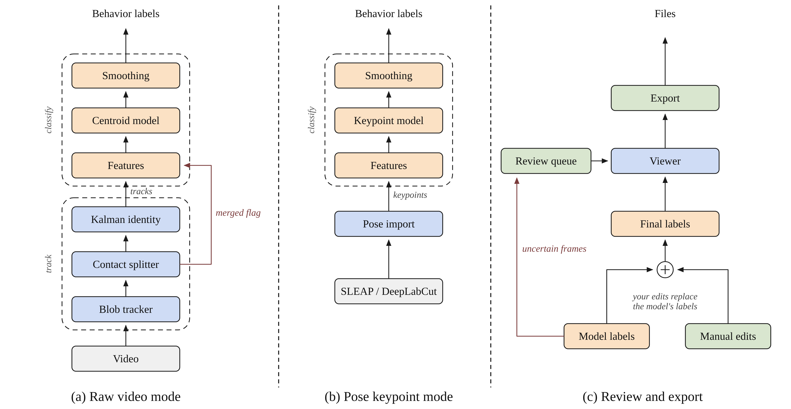

<div align="center">

  <h1>SCRUM</h1>
  <h2>Social Contact Recognition Using Motion</h2>

  <p>
    <a href="#features"><b>Features</b></a> |
    <a href="#installation"><b>Installation</b></a> |
    <a href="#citation"><b>Citation</b></a>
  </p>
</div>

<p align="center">
  
</p>

---

### Features

*   **Tracking & Identity:** Tracks animals across video frames, using a contact splitter and Kalman filter to maintain their identities when they overlap or merge.
*   **Behavior Classification:** Uses a model trained on CalMS21 to classify social behaviors. You can also skip tracking and import existing SLEAP or DeepLabCut keypoints.
*   **Desktop Reviewer:** A desktop app where you can review predictions, correct mistakes, and check low-confidence segments without changing the original model outputs.
*   **Export Tools:** Exports results as CSV files, BORIS-compatible events, annotated video clips, and PDF reports.

### Installation

SCRUM runs natively on macOS, Windows, and Linux. 

```bash
# Install from a clone of this repo (requires Python 3.10+)
pip install ".[gui]"     

# Launch the desktop viewer
scrum                    

# Track and classify a folder entirely headless
scrum detect clips/      
```

### Citation

```bibtex
@software{bulusu_scrum,
  author  = {Bulusu, Sai Karthik},
  title   = {SCRUM: Social Contact Recognition Using Motion},
  year    = {2026},
  url     = {https://github.com/skbulusu/SCRUM},
  version = {1.0.0}
}
```
